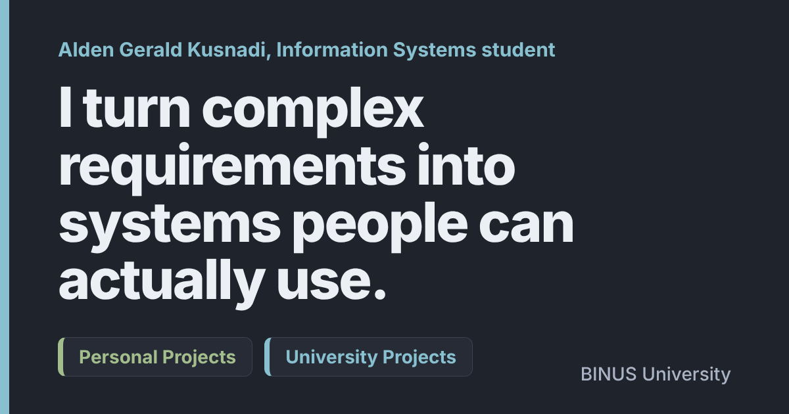

<div align="center">



# Alden Gerald Kusnadi

Information Systems student at BINUS University (Kemanggisan), and someone who just likes making things run.

[**alden-gerald.github.io/academic-portfolio**](https://alden-gerald.github.io/academic-portfolio/)


</div>

---

## What this is

The source of my portfolio site. Every project I show there lives in its own public repo, so the code and history stay where they belong. This repo only holds the page that ties them together.

I redesigned it to feel like an Apple product page: big type, full-width tiles, and things that move as you scroll. Not because it's the easiest way to list four school projects, but because I wanted to see if I could pull it off with nothing but the platform.

## What's on the page

**University projects**

| Project | What I did |
| --- | --- |
| [AWS Cloud Storage Strategy](https://github.com/Alden-Gerald/aws-cloud-storage-strategy) | Solo case study. Matched each workload of an education platform to a storage service (EBS, S3 + CloudFront, EFS, Glacier) and wrote down why. |
| [Hampiness](https://github.com/Alden-Gerald/hampiness-system-design) | Team project. I handled the analysis and design side: requirements, fishbone, DFDs, UML, and a three-tier architecture. |
| [Student Registration](https://github.com/Alden-Gerald/student-registration-javafx) | JavaFX + MySQL desktop CRUD app with validation and a separate DAO layer. |
| [ThriftVibe](https://github.com/Alden-Gerald/thriftvibe-marketplace) | Team marketplace with buyer, seller and admin sides. I built the pages and wired them to PHP and MySQL with prepared statements. |

**Personal**

| Project | Why it exists |
| --- | --- |
| [Lumina](https://github.com/Alden-Gerald/Lumina) | A local-first AI workspace (chat, study, files, coding) running on Ollama. I made it because I wanted to stop depending on cloud AI for everyday stuff. |

## How the page is built

- **No framework, no build step.** One `index.html`, one `style.css`, one `script.js`. Open the file and it works.
- **Scroll animation is CSS first.** Reveals, parallax and the progress bar use native scroll-driven animations (`animation-timeline: view()` and `scroll()`). Browsers without support get a small IntersectionObserver fallback.
- **Each project tile has the real app playing behind it.** The clips were recorded from the actual running apps, then compressed with ffmpeg (about 1.4 MB for all five). They only play while on screen and can be paused.
- **Image carousels** use scroll-snap, with a pill indicator and autoplay that stops as soon as you touch it.
- **The skills section** shows code scrolling in a fake editor window. The snippets are examples I wrote, not copied from my repos.
- **Accessibility:** with `prefers-reduced-motion` on, the animations and autoplay turn off and the videos sit on a still frame.
- Tested at 1920, 1440, 1366, 820, 390 and 360 px wide. No sideways scrolling at any of them.

## Run it locally

```bash
git clone https://github.com/Alden-Gerald/academic-portfolio.git
cd academic-portfolio
python3 -m http.server 8000
```

Then open <http://localhost:8000>. Any static server works. Don't open `index.html` straight from the disk, because the videos are picky about being served over HTTP.

## Folder map

```
index.html     the whole page
style.css      theme (Nord, darker), layout, animations
script.js      carousels, background video control, scroll fallbacks
shots/         screenshots used in the carousels (WebP)
demos/         short app recordings + poster frames (MP4 / JPG)
hero-bg.svg    hero artwork
og.png         link preview image
```

## About the screenshots

Everything shown comes from demo data I made up for this page. No real student records, user accounts or credentials appear anywhere, and the project repos use generic setup details.

If you spot something broken, a typo, or a layout that falls apart on your device, feel free to open an issue.
